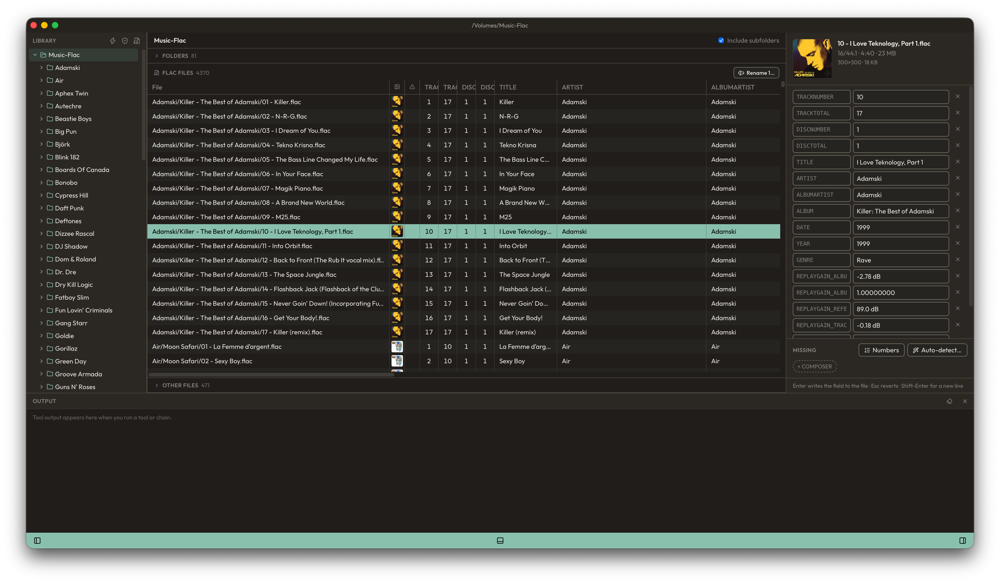

<div align="center">

# FLAC Tools

**A fast, no-nonsense tag editor and library tidier for FLAC collections on macOS.**

[Download the latest release](https://github.com/PaulChana/flac-tools/releases/latest) · macOS 14 or later · MIT licensed



</div>

> [!NOTE]
> If you use and enjoy this software, please make a donation to [Médecins Sans Frontières](https://www.msf.org/donate) (Doctors Without Borders). If you do, let me know and I'll add you to the About page ❤️

---

## What it's for

A big FLAC library rarely stays tidy. Rips from different years and different software end up with different
tag conventions: `1/2` crammed into the disc number, a `YEAR` that disagrees with `DATE`, `folder.jpg` in one album
and `front.png` in the next, stray ID3 tags left behind by MP3 tools, track names that live only in the file name.
Players and servers like Plex, Roon and Navidrome get confused by all of it, and fixing it by hand, one album at a
time, is no fun.

**FLAC Tools** is built to fix that. It shows a whole library at once, folder by folder, with every tag in its own
column, so problems stand out instead of hiding. You can edit one file or thousands, check folders for common
problems, and run a set of clean-up tools across the library, with a dry run first so you see exactly what will
change before anything does.

It started as a handful of [fish](https://fishshell.com) scripts for my own collection and grew into an app. The
scripts are still here and still work on their own from the terminal, if that's how you prefer to work.

## Features

### 🗂️ See the whole library at once

- A **folder tree** of your music library in the sidebar. Rename folders in place: double-click, press Enter, or right-click.
- **Tables** of subfolders, FLAC files and other files. Every tag found becomes a column, and cover thumbnails sit next to each track.
- Tick **Include subfolders** to see every track under a folder in one table, thousands of files deep.
- Details of the selected track: format, length, size and cover art.
- A `YEAR` that doesn't match `DATE` is highlighted, so mismatches jump out.

### ✏️ Edit tags quickly and safely

- Edit tags on **one file or many at once**. Press Enter to write a field, Esc to revert it.
- **Auto-detect** fills in tags from file and folder names, and **Numbers** changes how track and disc numbers are written.
- Add missing tags in one click, or remove ones you don't want.
- **Rename** files in bulk, using their tags in the new names, with a preview before anything changes.
- Edits that touch more than 20 files, or files in several folders, ask for confirmation first.

### 🩺 Find and fix problems

- **Check for problems** scans a folder for missing tags, stray ID3 tags, missing or non-square covers, track numbering, playlists and audio that doesn't decode cleanly, then offers fixes.

### 🧰 Clean-up tools, singly or in chains

- The **Tools** tab runs any of the bundled clean-up tools on the selected folder, **dry run by default**.
- Save tools as **chains** to run a whole clean-up routine in one go, like "fix disc numbers → embed cover → add ReplayGain".
- Fetch track names, tags and cover art from **MusicBrainz**.
- Add your own fish scripts from a folder of your choosing, and they appear alongside the built-in ones.

### 🎨 Made to feel at home

- A native macOS app, light and dark themes, a choice of accent colours and line spacing.
- Available in English, German, Spanish, French, Hindi, Japanese, Chinese, and Brazilian and European Portuguese.
- Signed and notarised by Apple.

## Install

With [Homebrew](https://brew.sh), which also installs `fish` and `flac`:

```sh
brew install --cask paulchana/tap/flac-tools
```

Or by hand:

1. Download `FLAC-Tools-<version>.dmg` from the [latest release](https://github.com/PaulChana/flac-tools/releases/latest).
2. Open it and drag **FLAC Tools** into **Applications**.
3. Open the app and choose your music folder (⌘O).

Some tools need command-line programs installed with [Homebrew](https://brew.sh):

```sh
brew install fish flac          # needed by all the tools
brew install jq                 # MusicBrainz tag and cover art lookups
brew install shntool cuetools   # splitting an album with a cue sheet
```

## The tools

Each tool is a fish script. The app runs them for you, but they also work on their own from a terminal. They work
on the current directory, or on `--path`, recursively, and every one takes `--help` to explain itself. Most take
`--dry-run` to show what they'd change without changing anything.

They're written for [fish](https://fishshell.com) on macOS. They may work on Linux, but that's untested.

| Tool | What it does |
| --- | --- |
| **Tags** | |
| `flac-fill-tags` | Fills in empty `ALBUMARTIST`, `COMPOSER`, `DISCNUMBER`, `DATE` and `GENRE` tags, locally or from MusicBrainz. |
| `flac-fill-track-names` | Names tracks from MusicBrainz: renames files to `NN - Title.flac` and sets their `TITLE` tags. |
| `flac-title-from-filename` | Sets each file's `TITLE` from its file name. |
| `flac-set-albumartist` | Sets `ALBUMARTIST` to the same name on every file. |
| `flac-copy-artist-to-albumartist` | Sets `ALBUMARTIST` to each file's `ARTIST`. |
| `flac-fix-artist-tag` | Replaces one `ARTIST` name with another on every file that has it. |
| `flac-set-genre` | Asks for a genre in a dialog, then sets `GENRE` on every file. |
| `flac-ensure-year-and-date-match` | Sets `YEAR` to the year in `DATE` wherever the two disagree. |
| `flac-fix-disc-number` | Splits disc numbers written like `1/2` into `DISCNUMBER` and `DISCTOTAL`. |
| `flac-set-disc-one` | Sets `DISCNUMBER` and `DISCTOTAL` to 1, for single-disc albums. |
| `flac-remove-tags` | Removes unwanted tags, keeping a sensible set by default. |
| `flac-remove-id3` | Strips stray ID3 tags, left behind by MP3 tools. |
| `flac-add-replaygain` | Computes ReplayGain for each album and adds the track and album gain tags. |
| **Cover art** | |
| `flac-download-album-art` | Downloads a `cover.jpg` from MusicBrainz for albums that don't have one. |
| `flac-ensure-cover` | Turns a `folder.jpg` or `front.jpg` into `cover.jpg`. |
| `flac-embed-cover-art` | Embeds each album's `cover.jpg` into its FLAC files. |
| `flac-extract-cover` | Saves the cover embedded in a FLAC file as `cover.jpg`. |
| `flac-restore-cover-backup` | Moves `cover.jpg` out of `albumart_backup` folders and deletes them. |
| `flac-test-for-square-cover` | Reports albums whose cover isn't square, or is missing. |
| `flac-remove-non-cover-images` | Deletes every image except `cover.jpg`, plus `Thumbs.db` files. |
| **Files and folders** | |
| `flac-rename-files` | Renames files by removing, replacing or trimming text in their names. |
| `flac-renumber-filename` | Renames `01 Name` to `01 - Name`. |
| `flac-ensure-lowercase-extensions` | Makes extensions lowercase, so `.FLAC` becomes `.flac`. |
| `flac-remove-date-prefix` | Removes a year from the front of folder names. |
| `flac-remove-extraneous-files` | Deletes everything except FLAC files and images. |
| `flac-make-tracks-from-cue` | Splits a whole-album FLAC into tracks using its cue sheet. |
| `flac-make-m3u` | Writes an `.m3u` playlist for each album. |
| **Reports** | |
| `flac-find-missing-info` | Reports files missing common tags or an embedded picture. |
| `flac-show-artist-tags` | Lists the `ARTIST` and `ALBUMARTIST` tags of every file. |
| `mp3-albums-with-flac` | Finds albums in an MP3 library that you also have in FLAC, and prints a script to move them aside. |

---

## For developers

The rest of this README covers building, testing and releasing the app.

### How it's built

FLAC Tools is a [Tauri 2](https://tauri.app) app: a Rust backend in `app/src-tauri/` and a Svelte 5 + TypeScript UI in `app/src/`, bundled with Vite. It builds for macOS only.

### Prerequisites

- **Xcode Command Line Tools**: `xcode-select --install`
- **Rust** (stable), via [rustup](https://rustup.rs): `curl --proto '=https' --tlsv1.2 -sSf https://sh.rustup.rs | sh`
- **Node.js** 20.19 or newer (Vite needs it), with npm: `brew install node`
- **just**, to run the build commands: `brew install just`
- **fish** and **flac**: `brew install fish flac`. The Tools tab runs the scripts with fish, and some Rust tests use the `flac` CLI to make test files. Without `flac` those tests pass without checking anything.

Some scripts need more tools, which you only need for those scripts: `brew install jq` (`flac-fill-tags`, `flac-download-album-art`) and `brew install shntool cuetools` (`flac-make-tracks-from-cue`).

### Build

From the repo root:

```sh
just build
```

This installs the npm packages if needed, builds the UI, compiles the Rust backend in release mode and bundles it. The app ends up at:

```
app/src-tauri/target/release/bundle/macos/FLAC Tools.app
```

The first build takes a few minutes while Cargo compiles the dependencies. Later builds are much faster.

This build is not signed (signed releases are made with `just release`, see [Releasing](#releasing)). It runs on the Mac that built it. To use it on another Mac you need to sign it, or clear the quarantine flag after copying it there: `xattr -cr "FLAC Tools.app"`.

### Other commands

Run `just` with no arguments to list them all.

| Command                          | What it does                                                                                                  |
| -------------------------------- | ------------------------------------------------------------------------------------------------------------- |
| `just deps`                      | Installs the npm packages, only when `package-lock.json` has changed. The other commands run this first.     |
| `just build`                     | Builds the release app bundle, `FLAC Tools.app` (unsigned).                                                   |
| `just dev`                       | Runs the app in development. The UI reloads when you save a file.                                             |
| `just ui`                        | Builds only the UI, into `app/dist`. The Rust app embeds it, so the Rust tests need it.                       |
| `just test`                      | Runs the Rust unit tests and the Svelte/TypeScript type check.                                                |
| `just test-rust`                 | Runs only the Rust unit tests.                                                                                |
| `just check`                     | Runs only the type check (`svelte-check`) and the translation check.                                          |
| `just install`                   | Builds the app and copies it into `/Applications`.                                                            |
| `just open`                      | Opens the built app.                                                                                          |
| `just clean`                     | Deletes the build output, `dist/` and `node_modules/`.                                                        |
| `just bump <version>`            | Sets the version in `Cargo.toml`, `tauri.conf.json` and `package.json`.                                       |
| `just release <version>`         | Bumps the version, commits, and pushes `main` and the `v<version>` tag. GitHub Actions then builds the release. |
| `just deploy`                    | Tests, then builds, signs and notarises the app and its DMG, into `release/dist/<version>/`.                  |
| `just notary-password <apple-id>` | Stores the Apple ID app-specific password used to notarise in the macOS Keychain. It prompts for the password and doesn't echo it. |
| `just notary-check`              | Checks the Developer ID certificate and the notarisation credentials.                                         |
| `just notarize-dmg`              | Notarises and staples the DMG from the last build. Use it to retry only that step.                            |

If you don't have `just`, the same steps by hand are:

```sh
cd app
npm ci                                                 # install dependencies
npm run tauri dev                                      # run in development
npm run tauri build                                    # build the .app
cargo test --manifest-path src-tauri/Cargo.toml        # Rust tests
npm run check                                          # type check
```

One test, `trashes_folders`, is skipped by default because it moves a folder to your Trash. Run it with `cargo test --manifest-path app/src-tauri/Cargo.toml -- --ignored`.

### Releasing

Releases are built, signed, notarised and published by the **Release** workflow
(`.github/workflows/release.yml`) when a `v*` tag is pushed. To make one:

1. Commit or finish the changes that go in the release, on `main`.
2. Write the release notes in `release/notes/<version>.md`, e.g. `release/notes/1.2.0.md`. Write what changed for people using the app, in Markdown. They become the GitHub release's description. See [release/notes/README.md](release/notes/README.md).
3. Run `just release <version>`, e.g. `just release 1.2.0`. It:
   - stops if you're not on `main`, if the notes file is missing, or if the tag already exists, locally or on GitHub
   - sets the version in `Cargo.toml`, `tauri.conf.json` and `package.json`
   - stages everything (`git add -A`) and shows what will be committed
   - asks for confirmation, then commits `Release <version>`, pushes `main`, and creates and pushes the `v<version>` tag

   If you answer no, the version bump stays in place and the changes stay staged.
4. Watch the run in the repo's **Actions** tab. The workflow checks the tag matches the version in `app/package.json` and that the notes exist, runs `just deploy`, then creates the GitHub release with the DMG attached as `FLAC-Tools-<version>.dmg`. A version with a hyphen, e.g. `1.3.0-beta.1`, is published as a pre-release.

The workflow needs these repository secrets:

| Secret                       | What it is                                                         |
| ---------------------------- | ------------------------------------------------------------------ |
| `APPLE_CERTIFICATE`          | The Developer ID Application certificate and key, as a base64 `.p12`. |
| `APPLE_CERTIFICATE_PASSWORD` | The password of that `.p12`.                                       |
| `APPLE_ID`                   | The Apple ID used to notarise.                                     |
| `APPLE_PASSWORD`             | An app-specific password for that Apple ID.                        |

#### Building a signed release locally

`just deploy` does the same build on your Mac, without publishing anything. It builds the version currently set in `app/package.json`; set that with `just bump <version>`. If the release notes are missing, it opens `$EDITOR` to write them, or reads them from the terminal. The DMG and notes end up in `release/dist/<version>/`.

It needs, once per Mac:

- the Developer ID Application certificate for team `M9T382L3AL` in your login keychain
- the Apple ID app-specific password, stored with `just notary-password <apple-id>`
- a notarytool profile, stored with `xcrun notarytool store-credentials flac-tools-notary --apple-id <apple-id> --team-id M9T382L3AL`

`just notary-check` confirms all three. If notarising the DMG fails, for example on a network error, run `just notarize-dmg` to retry that step without rebuilding.

### Where the app finds the scripts

The `flac-*.fish` scripts are copied into the app when it's built, so the app doesn't need the repo to run them. After editing a script, rebuild the app to pick up the change.

To use scripts of your own, or to try script edits without rebuilding, use the folder button in the Tools tab to add a folder of extra scripts. Its `.fish` scripts appear alongside the bundled ones. A script with the same name as a bundled one replaces it. Pointing it at this repo runs the repo's copies. A script in another folder can use the shared helpers with `source $FLAC_TOOLS_LIB`, which the app sets to the bundled `flac-lib.fish`.

### Translations

The interface is translated into German, English, Spanish, French, Hindi, Japanese, Brazilian and European Portuguese, and Chinese. Choose a language in Settings (⌘,). The translations are in `app/src/lib/locales`, one JSON file per language, keyed by the English text.

When you add or change text in the interface, wrap it in `$t("…")` (or `tr("…")` in a `.ts` file), then run `npm run i18n` in `app/`. That updates `en.json` and lists the strings each language is missing. `npm run check` fails until every language has them all, with the same `{placeholders}`.

### Open source licences

The About page lists the open source software in the app. `npm run build` regenerates the list (`app/src/lib/generated/licenses.ts`) from the Rust crates and npm packages the app depends on, plus the bundled fonts.

### Debugging in VS Code

`.vscode/` has launch configurations for the [CodeLLDB](https://marketplace.visualstudio.com/items?itemName=vadimcn.vscode-lldb) extension:

- **FLAC Tools (Debug)** starts the Vite dev server and runs a debug build under the debugger.
- **FLAC Tools (Release)** builds the UI and runs an optimised build, which behaves like the bundled app.

## License

[MIT](LICENSE)
